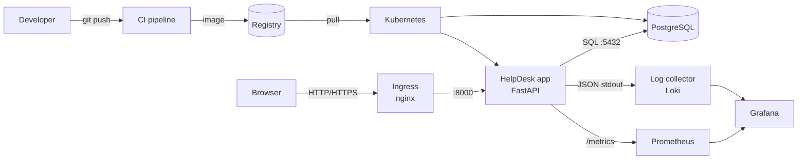

# Threat model — HelpDesk

Method: **STRIDE** per component, with a mapping to **OWASP Top 10:2021**.
Scope: the application, its container image, the CI pipeline, the Kubernetes
deployment, and the observability path. Out of scope: the underlying cloud
provider, the developer laptops, and the university network.

## 1. System description

HelpDesk is a ticket management application. Four roles exist:

| Role | Capabilities |
|---|---|
| `user` | Create tickets, read own tickets, comment on own tickets |
| `agent` | Read all tickets, add internal comments |
| `admin` | Manage users and roles |
| anonymous | Login page only |

Sensitive data: ticket contents, internal agent comments (MFA codes, salary
information), usernames, password hashes, session cookies, the session signing
key, database credentials, CI/CD secrets.

## 2. Data-flow diagram

Trust boundaries:

1. Internet → ingress (untrusted input, TLS termination).
2. Ingress → app (authenticated/unauthenticated HTTP).
3. App → database (SQL, credentials).
4. CI → registry → cluster (supply chain).
5. Cluster → observability backend (logs and metrics may contain sensitive
   fields if not redacted).

## 3. Assets and actors

| Asset | Why it matters |
|---|---|
| Ticket data and internal comments | Health/payroll/MFA data; privacy and fraud risk |
| User accounts and sessions | Account takeover, privilege escalation |
| Session signing key | Forgery of any session |
| Database credentials | Full data access |
| Container image | Supply-chain compromise |
| CI secrets and tokens | Repository/registry compromise |
| Cluster credentials | Lateral movement |

Actors: anonymous internet user, normal authenticated user, agent, admin,
malicious insider, attacker who obtained a leaked secret, compromised
dependency, and a careless developer who pushes a secret.

## 4. STRIDE analysis

| # | Component | Threat (STRIDE) | Scenario | Current control / gap | OWASP |
|---|---|---|---|---|---|
| T1 | Login | **S**poofing | Credential stuffing / brute force against `/login` | Password hashing (PBKDF2), generic error message; **no rate limiting** | A07 |
| T2 | Session | **S**poofing | Forge a cookie with the hardcoded key (V5) | Hardcoded key — **vulnerable**; fix: secret manager + rotation | A02/A07 |
| T3 | Ticket search | **T**ampering | SQL injection changes the query (V1) | String interpolation — **vulnerable**; fix: parameterised queries | A03 |
| T4 | Comments | **T**ampering | Stored XSS executes in agents' browsers (V2) | `|safe` — **vulnerable**; fix: autoescape + CSP | A03 |
| T5 | Ticket detail | **I**nformation disclosure | IDOR reads another user's ticket (V3) | No ownership check — **vulnerable**; fix: object-level authz | A01 |
| T6 | Admin area | **E**levation of privilege | Any user opens `/admin` and promotes themselves (V4) | No role check — **vulnerable**; fix: `require_admin` | A01 |
| T7 | Admin actions | **R**epudiation | Role changes are not attributable | Structured `admin.role_changed` event; needs retention/alerting | A09 |
| T8 | Container | **E**levation of privilege | Container runs as root / privileged | Multi-stage image, UID 10001, read-only rootfs, drop ALL, seccomp | A05 |
| T9 | Kubernetes | **E**levation of privilege | A non-hardened pod is scheduled | Kyverno admission policy (Enforce) + Pod Security restricted | A05 |
| T10 | Network | **I**nformation disclosure / lateral movement | App reaches arbitrary services; DB exposed | Default-deny NetworkPolicies + targeted allows | A05 |
| T11 | Dependencies | **T**ampering / **D**oS | Known CVE in `python-multipart` (V6) | Trivy SCA blocking High/Critical; fix by upgrade | A06 |
| T12 | CI/CD | **T**ampering | A secret or vulnerable image reaches production | Five blocking gates + branch protection | A05/A06 |
| T13 | Logs | **I**nformation disclosure | Passwords or tokens written to logs | Only metadata is logged; bodies are not logged; review on every change | A09 |
| T14 | Database | **D**enial of service | Connection exhaustion / heavy queries | Resource limits, readiness probes; no statement timeout yet | A05 |
| T15 | Ingress | **D**enial of service | Flood of requests | No rate limit/WAF in the demo; ingress-level limits recommended | A05 |
| T16 | Supply chain | **T**ampering | Malicious base image or dependency | Pinned versions, Trivy image scan, minimal image | A06 |

## 5. OWASP Top 10:2021 coverage

| OWASP category | Where it appears | Treatment |
|---|---|---|
| A01 Broken Access Control | V3 IDOR, V4 admin role | Fixed and retested with scripted DAST |
| A02 Cryptographic Failures | V5 hardcoded key, no TLS locally | Key rotated, secret manager, TLS at ingress in production |
| A03 Injection | V1 SQLi, V2 XSS | Parameterised queries, autoescaping, CSP |
| A04 Insecure Design | Missing rate limiting, no CSRF | Acknowledged; rate limiting recommended |
| A05 Security Misconfiguration | Container/K8s defaults | Hardened image, securityContext, Kyverno, netpol |
| A06 Vulnerable Components | V6 old multipart/Jinja | Upgraded, Trivy gate |
| A07 Auth Failures | V5, brute force | Rotated key, generic errors; rate limiting still a gap |
| A08 Software/Data Integrity | CI → registry | Pinned images, scan, branch protection; signing is a bonus |
| A09 Logging/Monitoring Failures | Attack detection | Structured logs, metrics, alert, IR plan |
| A10 SSRF | Not applicable (no outbound fetch feature) | Documented as not applicable |

## 6. Assumptions and limitations

- The cluster is local (kind). Cloud IAM, node hardening and network ACLs are
  out of scope.
- The database is a single replica with an `emptyDir` in the demo; production
  would use a managed database with backups and encryption at rest.
- The threat model is reviewed at each architecture change; it is not a
  one-time document.
- A passing pipeline does not prove the absence of vulnerabilities. The report
  must state what the controls do **not** cover (business logic, authorization
  semantics, zero-days, runtime behaviour).
